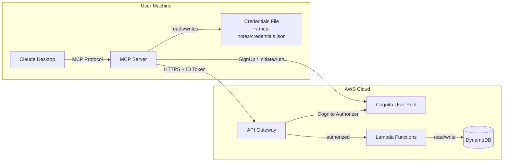
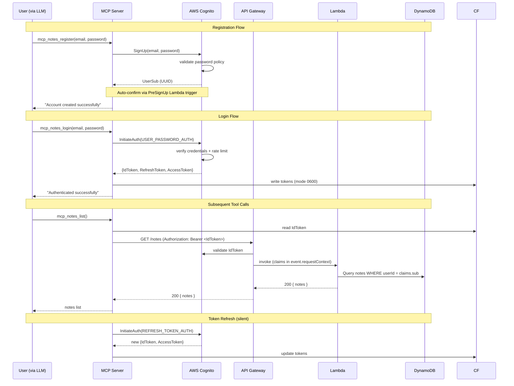

# Design Document: User Authentication

## Overview

This design describes the authentication system for mcp-notes, a personal note-taking application accessed exclusively via MCP (Model Context Protocol) from Claude Desktop. There is no graphical interface — all interactions happen through MCP tools exposed to the LLM.

The system follows a fully serverless architecture maximizing AWS Free Tier usage:

- **MCP Server** (local process): A TypeScript process using `@modelcontextprotocol/sdk` that runs on the user's machine, manages local credential storage (Cognito tokens), and proxies authenticated requests to API Gateway.
- **AWS Cognito** (auth): Manages user registration, login, password policies, token issuance, token validation, and rate limiting. No custom auth logic required.
- **API Gateway** (routing): REST API with a Cognito Authorizer that validates ID tokens before forwarding requests to Lambda.
- **AWS Lambda** (compute): Node.js/TypeScript functions that handle note CRUD operations, scoped by the Cognito user ID extracted from the validated token.
- **DynamoDB** (storage): Stores notes only. Users are managed entirely by Cognito.
- **AWS CDK** (deployment): TypeScript CDK stack defining all infrastructure.

Once authenticated, the MCP server attaches the Cognito ID token to every API Gateway request, enabling seamless access across all LLM conversations without re-authentication. The refresh token enables silent token renewal when the ID token expires.

## Architecture



### Authentication Flow



### Technology Stack

| Layer | Technology | Rationale |
|-------|-----------|-----------|
| MCP Server | TypeScript + `@modelcontextprotocol/sdk` | Native MCP support, type safety |
| Authentication | AWS Cognito User Pool | Managed auth with free tier (50,000 MAU), handles passwords, tokens, rate limiting |
| API | API Gateway REST API | Free tier (1M calls/month), native Cognito authorizer integration |
| Compute | AWS Lambda (Node.js 20) | Free tier (1M requests/month, 400,000 GB-sec), zero cost at personal scale |
| Database | DynamoDB | Free tier (25 GB storage, 25 RCU/WCU), single-table design, serverless |
| IaC | AWS CDK (TypeScript) | Type-safe infrastructure, same language as application code |
| Auth SDK | `@aws-sdk/client-cognito-identity-provider` | Official AWS SDK for Cognito operations from MCP server |

**Design Decision — Cognito over custom JWT:** Cognito provides built-in password hashing (SRP protocol), token issuance (JWT), rate limiting, and account management. This eliminates the need for bcrypt, custom JWT logic, and rate limiter implementation. The trade-off is vendor lock-in, but the simplicity and free tier make it ideal for a personal tool.

**Design Decision — DynamoDB over PostgreSQL:** DynamoDB's free tier (25 GB, 25 WCU/RCU) is permanently free (not time-limited). For a personal note-taking app with low traffic, this means zero ongoing cost. The single-table design with a partition key on `userId` naturally enforces data isolation.

**Design Decision — No email verification:** For a personal single-user tool, we use a PreSignUp Lambda trigger to auto-confirm users and auto-verify email attributes. This removes friction while still leveraging Cognito's auth infrastructure.

## Components and Interfaces

### MCP Server Tools

The MCP server exposes the following tools to the LLM:

| Tool | Parameters | Description |
|------|-----------|-------------|
| `mcp_notes_register` | `email: string, password: string` | Create a new account via Cognito SignUp |
| `mcp_notes_login` | `email: string, password: string` | Authenticate via Cognito and store tokens locally |
| `mcp_notes_logout` | none | Delete local credentials file |
| `mcp_notes_status` | none | Check if authenticated (token exists, refresh if expired) |

### Cognito Operations (from MCP Server)

The MCP server communicates directly with Cognito (no API Gateway needed for auth operations):

#### Register (SignUp)

```typescript
// MCP Server → Cognito
const command = new SignUpCommand({
  ClientId: COGNITO_CLIENT_ID,
  Username: email,
  Password: password,
  UserAttributes: [{ Name: 'email', Value: email }],
});
```

**Cognito responses mapped to user-facing errors:**
- Success: `{ UserSub: "uuid" }` → "Account created successfully"
- `UsernameExistsException` → `{ code: "EMAIL_ALREADY_EXISTS", message: "...", remedy: "..." }`
- `InvalidPasswordException` → `{ code: "VALIDATION_ERROR", message: "...", remedy: "..." }`
- `InvalidParameterException` → `{ code: "VALIDATION_ERROR", message: "...", remedy: "..." }`

#### Login (InitiateAuth)

```typescript
const command = new InitiateAuthCommand({
  ClientId: COGNITO_CLIENT_ID,
  AuthFlow: 'USER_PASSWORD_AUTH',
  AuthParameters: {
    USERNAME: email,
    PASSWORD: password,
  },
});
```

**Cognito responses mapped to user-facing errors:**
- Success: `{ AuthenticationResult: { IdToken, RefreshToken, AccessToken } }`
- `NotAuthorizedException` → `{ code: "AUTH_INVALID_CREDENTIALS", message: "...", remedy: "..." }`
- `UserNotFoundException` → `{ code: "AUTH_INVALID_CREDENTIALS", message: "...", remedy: "..." }` (same as above, no info leak)
- `TooManyRequestsException` → `{ code: "AUTH_RATE_LIMITED", message: "...", remedy: "..." }`

#### Token Refresh

```typescript
const command = new InitiateAuthCommand({
  ClientId: COGNITO_CLIENT_ID,
  AuthFlow: 'REFRESH_TOKEN_AUTH',
  AuthParameters: {
    REFRESH_TOKEN: storedRefreshToken,
  },
});
```

### API Gateway Endpoints (for note operations)

All endpoints are protected by the Cognito Authorizer. The Lambda receives the validated claims in `event.requestContext.authorizer.claims`.

| Method | Path | Description |
|--------|------|-------------|
| GET | /notes | List authenticated user's notes |
| POST | /notes | Create a new note |
| GET | /notes/{noteId} | Get a specific note |
| PUT | /notes/{noteId} | Update a note |
| DELETE | /notes/{noteId} | Delete a note |

### Credential Storage Module

The MCP server includes a `CredentialStore` module:

```typescript
interface CognitoTokens {
  idToken: string;
  refreshToken: string;
  accessToken: string;
  expiresAt: number; // Unix timestamp when idToken expires
}

interface CredentialStore {
  save(tokens: CognitoTokens): Promise<void>;    // Write tokens, set mode 0600
  load(): Promise<CognitoTokens | null>;          // Read tokens or null if missing
  delete(): Promise<void>;                        // Remove credentials file
  getPath(): string;                              // Returns ~/.mcp-notes/credentials.json
  isExpired(tokens: CognitoTokens): boolean;      // Check if idToken needs refresh
}
```

**Storage location:** `~/.mcp-notes/credentials.json`

**File format:**
```json
{
  "idToken": "eyJhbG...",
  "refreshToken": "eyJhbG...",
  "accessToken": "eyJhbG...",
  "expiresAt": 1705312200,
  "savedAt": "2024-01-15T10:30:00Z"
}
```

### Error Mapping Module

Maps Cognito exceptions to structured error responses for the LLM:

```typescript
interface AuthErrorResponse {
  code: string;
  message: string;
  remedy: string;
}

function mapCognitoError(error: CognitoError): AuthErrorResponse;
```

**Error mapping table:**

| Cognito Exception | Mapped Code | HTTP-like Status | Trigger |
|-------------------|-------------|------------------|---------|
| `NotAuthorizedException` | `AUTH_INVALID_CREDENTIALS` | 401 | Wrong email or password |
| `UserNotFoundException` | `AUTH_INVALID_CREDENTIALS` | 401 | Email not found (same error to prevent enumeration) |
| `TooManyRequestsException` | `AUTH_RATE_LIMITED` | 429 | Cognito built-in throttling |
| `UsernameExistsException` | `EMAIL_ALREADY_EXISTS` | 409 | Registration with existing email |
| `InvalidPasswordException` | `VALIDATION_ERROR` | 400 | Password doesn't meet policy |
| `InvalidParameterException` | `VALIDATION_ERROR` | 400 | Invalid email format |
| `NotAuthorizedException` (expired) | `AUTH_TOKEN_EXPIRED` | 401 | Refresh token expired |
| Token missing (local check) | `AUTH_REQUIRED` | 401 | No credentials file |

## Data Models

### DynamoDB Table: Notes

**Single-table design** with partition key on `userId` for natural data isolation:

| Attribute | Type | Key | Description |
|-----------|------|-----|-------------|
| `userId` | String (S) | Partition Key (PK) | Cognito User Pool `sub` (UUID) |
| `noteId` | String (S) | Sort Key (SK) | ULID for time-ordered notes |
| `title` | String (S) | — | Note title |
| `content` | String (S) | — | Note body (markdown) |
| `createdAt` | String (S) | — | ISO 8601 timestamp |
| `updatedAt` | String (S) | — | ISO 8601 timestamp |

**Access patterns:**
- List all notes for a user: `Query PK = userId`
- Get a single note: `GetItem PK = userId, SK = noteId`
- Create/Update a note: `PutItem PK = userId, SK = noteId`
- Delete a note: `DeleteItem PK = userId, SK = noteId`

**Data isolation guarantee:** Every DynamoDB operation includes `userId` (from the validated Cognito token claims) as the partition key. A user physically cannot query another user's partition without possessing their token.

### Cognito Token Structure (ID Token payload)

```typescript
interface CognitoIdTokenPayload {
  sub: string;          // User UUID (unique identifier)
  email: string;        // User's email
  email_verified: boolean;
  iss: string;          // Cognito issuer URL
  aud: string;          // Client ID
  token_use: 'id';
  auth_time: number;    // Authentication time
  exp: number;          // Expiration (1 hour from issuance)
  iat: number;          // Issued at
}
```

**Token lifetimes (Cognito User Pool configuration):**
- ID Token: 1 hour (Cognito minimum, non-configurable below this)
- Access Token: 1 hour
- Refresh Token: 90 days (exceeds the 30-day minimum requirement)

The refresh token's 90-day validity satisfies Requirement 3.2 (minimum 30-day validity). The MCP server silently refreshes the ID token using the refresh token, so the user never needs to re-authenticate within 90 days.

### CDK Stack Structure

```typescript
// lib/mcp-notes-stack.ts
export class McpNotesStack extends cdk.Stack {
  constructor(scope: Construct, id: string, props?: cdk.StackProps) {
    // 1. Cognito User Pool
    // 2. Cognito User Pool Client
    // 3. DynamoDB Table
    // 4. Lambda Functions (notes CRUD + PreSignUp trigger)
    // 5. API Gateway REST API with Cognito Authorizer
  }
}
```

### Cognito User Pool Configuration (CDK)

```typescript
const userPool = new cognito.UserPool(this, 'McpNotesUserPool', {
  selfSignUpEnabled: true,
  signInAliases: { email: true },
  autoVerify: { email: true },
  passwordPolicy: {
    minLength: 8,                    // Requirement 2.2
    requireLowercase: false,         // Keep simple for personal use
    requireUppercase: false,
    requireDigits: false,
    requireSymbols: false,
  },
  accountRecovery: cognito.AccountRecovery.NONE, // No recovery for simplicity
  removalPolicy: cdk.RemovalPolicy.RETAIN,
});

// PreSignUp trigger to auto-confirm users (no email verification needed)
const preSignUpFn = new lambda.Function(this, 'PreSignUpFn', { ... });
userPool.addTrigger(cognito.UserPoolOperation.PRE_SIGN_UP, preSignUpFn);

const userPoolClient = userPool.addClient('McpNotesClient', {
  authFlows: {
    userPassword: true,   // USER_PASSWORD_AUTH for direct email/password login
  },
  generateSecret: false,  // Public client (MCP server is local)
  idTokenValidity: cdk.Duration.hours(1),
  refreshTokenValidity: cdk.Duration.days(90),  // Requirement 3.2: min 30 days
  accessTokenValidity: cdk.Duration.hours(1),
});
```

### API Gateway Configuration (CDK)

```typescript
const api = new apigateway.RestApi(this, 'McpNotesApi', {
  restApiName: 'mcp-notes-api',
  deployOptions: { stageName: 'prod' },
});

const authorizer = new apigateway.CognitoUserPoolsAuthorizer(this, 'McpNotesAuthorizer', {
  cognitoUserPools: [userPool],
});

const notes = api.root.addResource('notes');
notes.addMethod('GET', new apigateway.LambdaIntegration(listNotesFn), {
  authorizer,
  authorizationType: apigateway.AuthorizationType.COGNITO,
});
// ... POST, GET/{noteId}, PUT/{noteId}, DELETE/{noteId}
```

### Lambda Function Design

Each Lambda function:
1. Extracts `userId` from `event.requestContext.authorizer.claims.sub`
2. Uses `userId` as the partition key for all DynamoDB operations
3. Returns structured JSON responses

```typescript
// Shared handler pattern
export const handler = async (event: APIGatewayProxyEvent): Promise<APIGatewayProxyResult> => {
  const userId = event.requestContext.authorizer?.claims?.sub;
  if (!userId) {
    return { statusCode: 401, body: JSON.stringify({ code: 'AUTH_REQUIRED', ... }) };
  }
  // ... DynamoDB operations scoped to userId
};
```

**Lambda functions:**

| Function | Trigger | Purpose |
|----------|---------|---------|
| `preSignUp` | Cognito PreSignUp | Auto-confirm user, auto-verify email |
| `listNotes` | GET /notes | Query DynamoDB for user's notes |
| `createNote` | POST /notes | PutItem with userId + new noteId |
| `getNote` | GET /notes/{noteId} | GetItem with userId + noteId |
| `updateNote` | PUT /notes/{noteId} | PutItem (conditional on userId match) |
| `deleteNote` | DELETE /notes/{noteId} | DeleteItem with userId + noteId |

### How Cognito Maps to Each Requirement

| Requirement | Implementation |
|-------------|---------------|
| 1. Account creation | Cognito `SignUp` API. Email uniqueness enforced by Cognito. Email format validated by Cognito (`InvalidParameterException` for invalid emails). |
| 2. Password security | Cognito password policy (`minLength: 8`). Cognito handles hashing internally (SRP protocol, never stores plaintext). Passwords never appear in any Cognito API response. |
| 3. Token issuance | Cognito `InitiateAuth` returns ID + Refresh tokens. Refresh token valid 90 days (>30 day minimum). Cognito returns same error for wrong email and wrong password (no enumeration). Token `sub` = unique user ID. |
| 4. Local token storage | MCP server stores Cognito tokens in `~/.mcp-notes/credentials.json` with mode 0600. Reads at startup. |
| 5. Token validation | API Gateway Cognito Authorizer validates ID token signature + expiry. Returns 401 for expired/invalid/missing tokens. |
| 6. Data isolation | Lambda extracts `sub` from validated token. All DynamoDB queries use `userId` as partition key. Impossible to access another user's partition. |
| 7. Error messages | MCP server maps Cognito exceptions to structured `{code, message, remedy}` responses. |
| 8. Rate limiting | Cognito's built-in throttling blocks excessive auth attempts. Returns `TooManyRequestsException`. No custom implementation needed. |

## Correctness Properties

*A property is a characteristic or behavior that should hold true across all valid executions of a system — essentially, a formal statement about what the system should do. Properties serve as the bridge between human-readable specifications and machine-verifiable correctness guarantees.*

### Property 1: Email validation correctness

*For any* string, the client-side email validation function SHALL accept it if and only if it conforms to the pattern `local-part@domain` (contains exactly one `@`, non-empty local part, non-empty domain with at least one dot).

**Validates: Requirements 1.4**

### Property 2: Password length validation

*For any* string of length less than 8 characters, the client-side password validation SHALL reject it with error code `VALIDATION_ERROR`. *For any* string of length 8 or more characters, the password SHALL pass the length validation check.

**Validates: Requirements 2.2, 2.3**

### Property 3: Credential file round-trip

*For any* valid `CognitoTokens` object (containing non-empty idToken, refreshToken, accessToken, and a numeric expiresAt), calling `credentialStore.save(tokens)` followed by `credentialStore.load()` SHALL return an object with identical field values.

**Validates: Requirements 4.1**

### Property 4: Credential file permissions invariant

*For any* call to `credentialStore.save(tokens)`, the resulting file on disk SHALL have Unix permissions mode `0600` (owner read/write only).

**Validates: Requirements 4.2**

### Property 5: Error mapping completeness

*For any* Cognito exception produced by the `mapCognitoError` function, the returned error response SHALL contain all three fields: `code` (non-empty string), `message` (non-empty string), and `remedy` (non-empty string with an actionable instruction).

**Validates: Requirements 7.1, 7.2**

### Property 6: Error mapping does not leak credential distinction

*For any* login failure — whether caused by `NotAuthorizedException` (wrong password) or `UserNotFoundException` (unknown email) — the `mapCognitoError` function SHALL produce the same error code (`AUTH_INVALID_CREDENTIALS`) and the message SHALL NOT reveal whether the email or password was incorrect.

**Validates: Requirements 3.3, 3.4**

### Property 7: Data isolation via partition key

*For any* Lambda handler invocation with a given `userId` in claims, *for any* DynamoDB operation constructed by that handler, the operation's key condition SHALL include `userId` as the partition key value equal to the claims `sub`. No operation SHALL reference a different user's partition.

**Validates: Requirements 6.1, 6.2, 6.3**

### Property 8: Token expiration detection

*For any* `CognitoTokens` object where `expiresAt` is less than the current timestamp, `credentialStore.isExpired(tokens)` SHALL return `true`. *For any* `CognitoTokens` object where `expiresAt` is greater than the current timestamp, it SHALL return `false`.

**Validates: Requirements 5.3**

## Error Handling

### Error Handling Strategy

The system uses a unified error response format. Errors are handled at two layers:

#### MCP Server Layer (Cognito Error Mapping)

The MCP server catches Cognito SDK exceptions and maps them to structured responses:

```typescript
function mapCognitoError(error: unknown): AuthErrorResponse {
  if (error instanceof UsernameExistsException) {
    return {
      code: 'EMAIL_ALREADY_EXISTS',
      message: 'An account with this email already exists.',
      remedy: 'Use the login command with your existing credentials, or use a different email.',
    };
  }
  if (error instanceof NotAuthorizedException || error instanceof UserNotFoundException) {
    return {
      code: 'AUTH_INVALID_CREDENTIALS',
      message: 'Invalid email or password.',
      remedy: 'Check your email and password and try again.',
    };
  }
  if (error instanceof TooManyRequestsException) {
    return {
      code: 'AUTH_RATE_LIMITED',
      message: 'Too many authentication attempts. Please wait before trying again.',
      remedy: 'Wait a few minutes before attempting to log in again.',
    };
  }
  if (error instanceof InvalidPasswordException) {
    return {
      code: 'VALIDATION_ERROR',
      message: 'Password does not meet requirements.',
      remedy: 'Password must be at least 8 characters long.',
    };
  }
  // ... other mappings
}
```

The MCP server presents errors as tool results:

```typescript
return {
  content: [{
    type: 'text',
    text: `Authentication error: ${error.message}\n\nWhat to do: ${error.remedy}`
  }],
  isError: true
};
```

#### Lambda Layer (API errors)

Lambda functions return structured JSON error responses for data access issues:

```typescript
// Note not found (or belongs to another user — same response)
return {
  statusCode: 404,
  body: JSON.stringify({
    code: 'NOTE_NOT_FOUND',
    message: 'The requested note was not found.',
    remedy: 'Verify the note ID and try again.',
  }),
};
```

#### Error Propagation Chain

```
Cognito exception / API Gateway 401
  → MCP Server catches error
    → mapCognitoError produces structured response
      → MCP Server formats as tool error result
        → LLM reads error and explains to user
```

### Edge Cases

| Scenario | Handling |
|----------|----------|
| Cognito service outage | MCP server catches network errors, returns `SERVICE_UNAVAILABLE` with remedy "try again" |
| ID token expired, refresh token valid | MCP server silently refreshes using `REFRESH_TOKEN_AUTH` flow |
| ID token expired, refresh token expired | Return `AUTH_TOKEN_EXPIRED` with remedy "run login command" |
| Credentials file corrupted/malformed | `load()` returns null, user prompted to re-authenticate |
| DynamoDB throttling | Lambda returns 503, MCP server suggests retrying |
| Concurrent registration same email | Cognito enforces uniqueness atomically, second attempt gets `UsernameExistsException` |
| Lambda cold start | Acceptable latency (< 1s for Node.js); no special handling needed |
| API Gateway timeout (29s) | DynamoDB operations are fast; unlikely to hit. Log and return 504 if it occurs. |

## Testing Strategy

### Property-Based Testing

**Library:** [fast-check](https://github.com/dubzzz/fast-check) (TypeScript-native PBT library, integrates with Vitest)

**Configuration:**
- Minimum 100 iterations per property test
- Each test tagged with: `Feature: user-authentication, Property {N}: {description}`

**Properties to implement as PBT:**
- Property 1: Email validation correctness (pure function, all input space)
- Property 2: Password length validation (pure function, all input space)
- Property 3: Credential file round-trip (local I/O, mock filesystem)
- Property 4: Credential file permissions (local I/O, mock filesystem)
- Property 5: Error mapping completeness (pure function, all Cognito exception types)
- Property 6: Error mapping non-leakage (pure function, specific exception subset)
- Property 7: Data isolation via partition key (mock DynamoDB client, verify constructed operations)
- Property 8: Token expiration detection (pure function, time comparison)

**Properties requiring mocks for cost-efficiency:**
- Properties 3, 4: Mock filesystem (memfs or temp directory)
- Property 7: Mock DynamoDB DocumentClient, inspect constructed commands
- Property 8: Injectable clock for time-based assertions

### Unit Tests (Example-Based)

Focus on specific examples and edge cases not well covered by PBT:

- Credentials file does not exist at startup → returns null (Req 4.4)
- Request without Authorization header → API Gateway returns 401 (Req 5.5)
- Specific Cognito error codes mapped to specific structured errors (Req 7.3, 7.4, 7.5)
- MCP server startup sequence with/without credentials file
- PreSignUp Lambda trigger auto-confirms user
- Token refresh flow when ID token expired but refresh token valid
- Silent token refresh failure → prompt user to re-login

### Integration Tests

End-to-end flows against a deployed stack (or localstack):

- Full registration → login → list notes flow
- Token refresh after ID token expiry
- Cognito rate limiting behavior (verify throttling kicks in)
- DynamoDB data isolation (create 2 users, verify no cross-access)
- CDK synth → snapshot test for infrastructure correctness

### CDK Infrastructure Tests

```typescript
// CDK assertion tests (snapshot-based)
const app = new cdk.App();
const stack = new McpNotesStack(app, 'TestStack');
const template = Template.fromStack(stack);

template.hasResourceProperties('AWS::Cognito::UserPool', {
  Policies: { PasswordPolicy: { MinimumLength: 8 } },
});
template.hasResourceProperties('AWS::DynamoDB::Table', {
  KeySchema: [
    { AttributeName: 'userId', KeyType: 'HASH' },
    { AttributeName: 'noteId', KeyType: 'RANGE' },
  ],
});
template.hasResourceProperties('AWS::ApiGateway::Authorizer', {
  Type: 'COGNITO_USER_POOLS',
});
```

### Test Organization

```
tests/
  unit/
    validators/
      email.property.test.ts       # Property 1
      password.property.test.ts    # Property 2
    storage/
      credentials.property.test.ts # Properties 3, 4
    errors/
      mapping.property.test.ts     # Properties 5, 6
    lambda/
      data-isolation.property.test.ts # Property 7
    auth/
      token-expiry.property.test.ts   # Property 8
  integration/
    auth-flow.test.ts              # Full registration + login + access
    data-isolation.test.ts         # Cross-user isolation
    token-refresh.test.ts          # Silent refresh flow
  cdk/
    stack.test.ts                  # CDK snapshot + assertion tests
```
