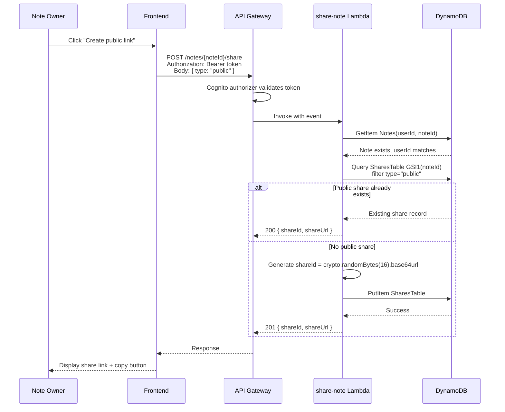
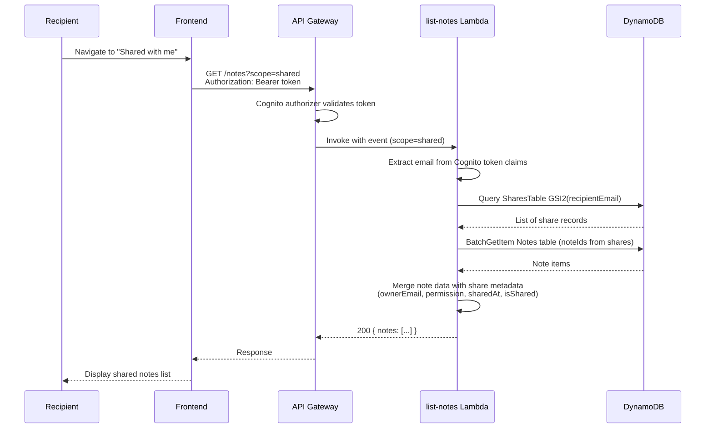
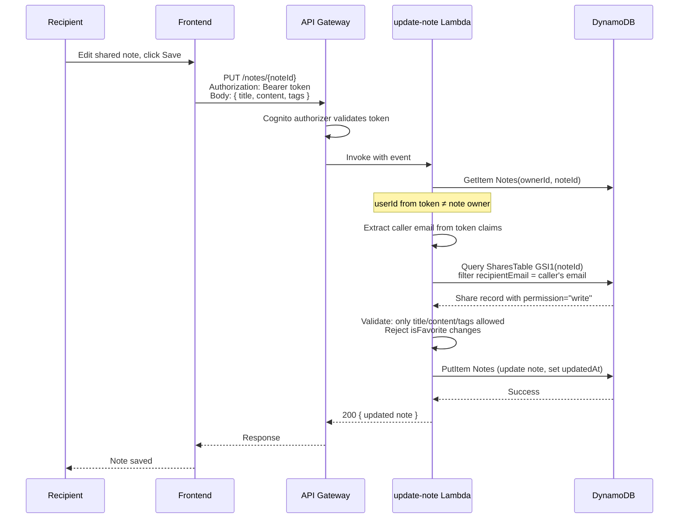
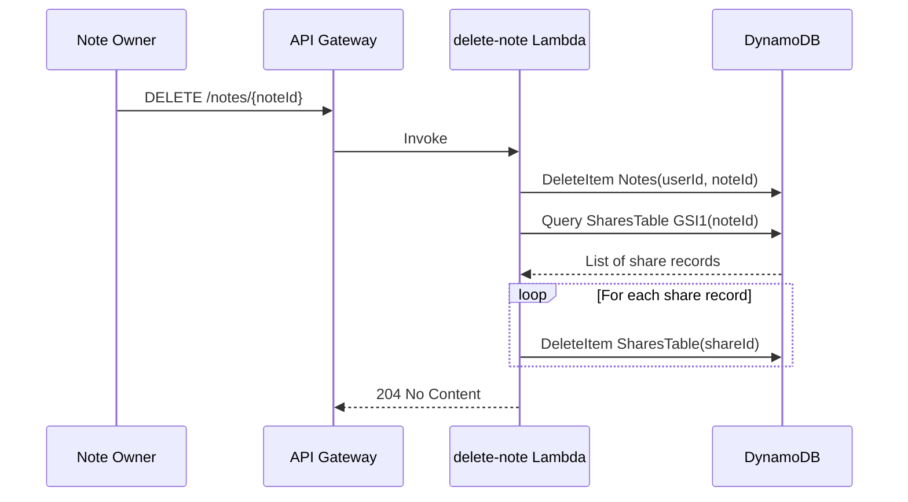

# Design Document: Share Notes

## Overview

This design adds note sharing to Notlai, enabling two sharing modes:

1. **Public links** — generate a unique, unguessable URL that renders the note read-only without authentication.
2. **User shares** — share a note with a registered user by email, with configurable permission (read or read+write).

The feature integrates across all layers: CDK infrastructure (new DynamoDB table + GSIs, new Lambda functions, new API Gateway routes), React frontend (share modal, public shared page, "Shared with me" section), and MCP server (new tools).

### Key Design Decisions

| Decision | Choice | Rationale |
|----------|--------|-----------|
| Share ID generation | `crypto.randomBytes(16).toString('base64url')` → 22 chars | 128 bits entropy, URL-safe, unguessable |
| Shares storage | Dedicated DynamoDB table | Clean separation, independent scaling, avoids hot partitions on notes table |
| Public endpoint auth | No Cognito authorizer on `GET /shared/{shareId}` | Must be accessible without account |
| Permission model | "read" / "write" enum | Simple, covers requirements, extensible later |
| Cascade deletion | Application-level (query GSI + batch delete) | DynamoDB has no FK constraints; Streams would add complexity |
| Recipient resolution | By email at query time, not at share time | Allows sharing before recipient signs up |
| Shared notes listing | Merged into existing `GET /notes` with `scope` query param | Avoids a dedicated Lambda, reuses existing infrastructure, simpler MCP integration |

## Architecture

### High-Level Component Diagram

```mermaid
graph TB
    subgraph Frontend["Frontend (React SPA)"]
        SM[Share Modal]
        SP[Shared Note Page<br/>/shared/:shareId]
        SWM[Shared With Me Section]
        ND[Note Detail Page]
    end

    subgraph API["API Gateway (api.notlai.com)"]
        AUTH[Cognito Authorizer]
        NOAUTH[No Auth]
    end

    subgraph Lambda["Lambda Functions"]
        SN[share-note]
        UN[unshare-note]
        GSN[get-shared-note]
        LN[list-notes<br/>modified: scope param]
        UPN[update-note<br/>modified]
        DN[delete-note<br/>modified]
    end

    subgraph DynamoDB
        NT[Notes Table]
        ST[Shares Table]
    end

    subgraph MCP["MCP Server (notlai-mcp)"]
        T1[notlai_share_note]
        T2[notlai_unshare_note]
        T3[notlai_list_notes<br/>scope param]
    end

    SM --> |POST /notes/{noteId}/share| AUTH
    SM --> |DELETE /notes/{noteId}/share| AUTH
    SP --> |GET /shared/{shareId}| NOAUTH
    SWM --> |GET /notes?scope=shared| AUTH
    ND --> |PUT /notes/{noteId}| AUTH

    AUTH --> SN
    AUTH --> UN
    NOAUTH --> GSN
    AUTH --> LN
    AUTH --> UPN
    AUTH --> DN

    SN --> ST
    SN --> NT
    UN --> ST
    GSN --> ST
    GSN --> NT
    LN --> ST
    LN --> NT
    UPN --> ST
    UPN --> NT
    DN --> ST
    DN --> NT

    T1 --> AUTH
    T2 --> AUTH
    T3 --> AUTH
```

### Sequence Diagrams

#### Public Link Creation



#### Listing Shared Notes (scope=shared)



#### Recipient Accessing Shared Note (Write Permission)



#### Cascade Deletion on Note Delete



## Components and Interfaces

### New Lambda Functions

| Function | Route | Auth | Description |
|----------|-------|------|-------------|
| `share-note` | `POST /notes/{noteId}/share` | Cognito | Create public link or user share |
| `unshare-note` | `DELETE /notes/{noteId}/share` | Cognito | Revoke public link or user share |
| `get-shared-note` | `GET /shared/{shareId}` | None | Fetch note content for public/anonymous access |

### Modified Lambda Functions

| Function | Changes |
|----------|---------|
| `list-notes` | Add `scope` query parameter support ("own" / "shared" / "all"). When scope=shared: query GSI2 by caller's email, batch-get notes, return with share metadata. When scope=all: merge own + shared notes. Default (scope=own): existing behavior unchanged. |
| `update-note` | Add share permission check: if caller ≠ owner, extract caller email from token, query Shares table GSI1 by noteId filtered by recipientEmail. Allow update only if share exists with permission="write", restricted to title/content/tags fields only. Reject isFavorite modifications. Return 403 INSUFFICIENT_PERMISSIONS for read-only shares, 404 NOTE_NOT_FOUND if no share exists. |
| `delete-note` | After deleting note, cascade-delete all associated share records via GSI1 |

### Update-Note Permission Enforcement Logic

The `update-note` Lambda must implement the following authorization flow:

1. Extract `userId` from Cognito token (`sub` claim)
2. Extract `email` from Cognito token (`email` claim)
3. `GetItem` the note from Notes table
4. **If `note.userId === caller userId`** → owner, allow full update (existing behavior)
5. **If `note.userId !== caller userId`** → recipient path:
   - Query Shares table GSI1 by `noteId`, filter by `recipientEmail` matching caller's email
   - **If share exists with `permission="write"`**: allow update of `title`, `content`, `tags` ONLY. Reject any attempt to modify `isFavorite`. The `updatedAt` is set by the Lambda.
   - **If share exists with `permission="read"`**: reject with 403 `INSUFFICIENT_PERMISSIONS`
   - **If no share exists**: reject with 404 `NOTE_NOT_FOUND` (don't reveal existence)

### API Contracts

#### POST /notes/{noteId}/share

**Request:**
```typescript
// Public link
{ "type": "public" }

// User share
{ "type": "user", "email": "recipient@example.com", "permission": "read" | "write" }
```

**Response (201 Created / 200 OK):**
```typescript
// Public link
{ "shareId": "abc123...", "shareUrl": "https://www.notlai.com/shared/abc123...", "type": "public", "permission": "read" }

// User share
{ "shareId": "def456...", "type": "user", "email": "recipient@example.com", "permission": "read" | "write", "createdAt": "..." }
```

**Errors:**
- 400: Invalid request body (bad email format, invalid permission value)
- 401: Not authenticated
- 403: User does not own the note
- 404: Note not found

#### DELETE /notes/{noteId}/share

**Request (query params):**
```
?type=public           → Revoke public link
?email=user@example.com → Revoke specific user share
```

**Response:** 204 No Content

**Errors:**
- 401: Not authenticated
- 403: User does not own the note

#### GET /shared/{shareId}

**No authentication required.**

**Response (200):**
```typescript
{
  "title": "Note Title",
  "content": "# Markdown content...",
  "createdAt": "2025-01-15T...",
  "updatedAt": "2025-01-16T..."
}
```

Note: Response deliberately omits userId, noteId, tags, isFavorite to protect owner privacy.

**Errors:**
- 404: Share not found or revoked

#### GET /notes?scope=shared|own|all

**Query Parameters:**
- `scope` (optional): `"own"` (default) | `"shared"` | `"all"`

**Behavior by scope:**

- **`scope=own`** (default, omitted): Existing behavior — returns the caller's own notes.
- **`scope=shared`**: Query GSI2 (RecipientEmailIndex) using the caller's email from the Cognito token. Batch-get the actual notes from the Notes table. Return notes enriched with share metadata.
- **`scope=all`**: Merge both own notes and shared notes in the response.

**Response (200) — scope=shared or scope=all (shared notes portion):**
```typescript
{
  "notes": [
    {
      "noteId": "...",
      "title": "...",
      "content": "...",
      "tags": ["..."],
      "isFavorite": false,        // always false for shared notes (owner's preference)
      "createdAt": "...",
      "updatedAt": "...",
      // Extra fields for shared notes:
      "isShared": true,
      "ownerEmail": "owner@example.com",
      "permission": "read" | "write",
      "sharedAt": "..."
    }
  ]
}
```

**Response (200) — scope=own (own notes):**
```typescript
{
  "notes": [
    {
      "noteId": "...",
      "title": "...",
      "content": "...",
      "tags": ["..."],
      "isFavorite": true | false,
      "createdAt": "...",
      "updatedAt": "..."
      // No isShared, ownerEmail, permission, or sharedAt fields
    }
  ]
}
```

Own notes do NOT include `isShared`, `ownerEmail`, `permission`, or `sharedAt` fields.

### Frontend Components

| Component | Location | Description |
|-----------|----------|-------------|
| `ShareModal` | `src/frontend/components/ShareModal.tsx` | Modal with public link + user share tabs |
| `SharedNotePage` | `src/frontend/pages/SharedNotePage.tsx` | Public shared note render (no auth required) |
| `SharedWithMePage` | `src/frontend/pages/SharedWithMePage.tsx` | List of notes shared with current user (calls GET /notes?scope=shared) |
| `PermissionBadge` | `src/frontend/components/PermissionBadge.tsx` | Visual badge for read/write permission |

### Router Changes

```typescript
// New routes in Router.tsx
<Route path="/shared/:shareId" element={<SharedNotePage />} />
<Route path="/shared-with-me" element={<RequireAuth><SharedWithMePage /></RequireAuth>} />
```

### MCP Server Tools

| Tool | Parameters | Description |
|------|-----------|-------------|
| `notlai_share_note` | `noteId`, optional `email`, optional `permission` | If email omitted → public link; if email → user share |
| `notlai_unshare_note` | `noteId`, optional `email` | If email omitted → revoke public link; if email → revoke user share |
| `notlai_list_notes` | existing params + optional `scope` ("own" \| "shared" \| "all", defaults to "own") | When scope=shared: returns notes shared with current user including ownerEmail and permission. When scope=all: merges own + shared notes. |

## Data Models

### Shares Table Schema

```
Table: McpNotesSharesTable
Billing: PAY_PER_REQUEST
Removal: RETAIN

Primary Key:
  PK: shareId (String) — base64url encoded 16 random bytes (22 chars)

Attributes:
  - shareId: String (PK)
  - userId: String — Cognito sub of the note owner
  - noteId: String — reference to the shared note
  - type: String — "public" | "user"
  - permission: String — "read" | "write"
  - recipientEmail: String — present only when type="user"
  - createdAt: String — ISO 8601 timestamp

GSI1 (NoteIdIndex):
  PK: noteId (String)
  Projection: ALL
  Purpose: Find all shares for a given note (cascade delete, list shares, permission check on update)

GSI2 (RecipientEmailIndex):
  PK: recipientEmail (String)
  Projection: ALL
  Purpose: Find all notes shared with a given user (GET /notes?scope=shared)
```

### TypeScript Interfaces

```typescript
interface ShareRecord {
  shareId: string;        // PK, 22-char base64url
  userId: string;         // note owner's Cognito sub
  noteId: string;         // reference to Notes table
  type: 'public' | 'user';
  permission: 'read' | 'write';
  recipientEmail?: string; // only for type="user"
  createdAt: string;       // ISO 8601
}

interface ShareNoteRequest {
  type: 'public' | 'user';
  email?: string;          // required when type="user"
  permission?: 'read' | 'write'; // default "read"
}

interface SharedNoteResponse {
  title: string;
  content: string;
  createdAt: string;
  updatedAt: string;
}

interface SharedNoteItem {
  noteId: string;
  title: string;
  content: string;
  tags: string[];
  isFavorite: false;       // always false for shared notes
  createdAt: string;
  updatedAt: string;
  isShared: true;
  ownerEmail: string;
  permission: 'read' | 'write';
  sharedAt: string;
}

interface OwnNoteItem {
  noteId: string;
  title: string;
  content: string;
  tags: string[];
  isFavorite: boolean;
  createdAt: string;
  updatedAt: string;
}

type ListNotesScope = 'own' | 'shared' | 'all';
```

### Share ID Generation

```typescript
import { randomBytes } from 'node:crypto';

function generateShareId(): string {
  return randomBytes(16).toString('base64url'); // 22 chars, 128 bits entropy
}
```

## Correctness Properties

*A property is a characteristic or behavior that should hold true across all valid executions of a system — essentially, a formal statement about what the system should do. Properties serve as the bridge between human-readable specifications and machine-verifiable correctness guarantees.*

### Property 1: Public share idempotence

*For any* note owned by a user, calling the public-share operation twice SHALL return the same shareId without creating a duplicate Share_Record.

**Validates: Requirements 1.3**

### Property 2: Public shares are always read-only

*For any* Share_Record with type "public", the permission field SHALL always be "read".

**Validates: Requirements 1.4**

### Property 3: Ownership authorization

*For any* user A and note owned by user B where A ≠ B, attempting to create a share SHALL be rejected with 403.

**Validates: Requirements 1.6**

### Property 4: Permission enforcement for read recipients

*For any* note shared with a recipient at "read" permission, the recipient SHALL be able to retrieve the note but any update attempt SHALL be rejected.

**Validates: Requirements 2.3**

### Property 5: Write permission boundaries

*For any* note shared with a recipient at "write" permission, updates to title, content, and tags SHALL succeed, but attempts to modify isFavorite, delete the note, or manage shares SHALL be rejected.

**Validates: Requirements 2.4**

### Property 6: User share upsert (no duplicates)

*For any* note/email pair, sharing multiple times with different permissions SHALL result in exactly one Share_Record with the latest permission value.

**Validates: Requirements 2.6**

### Property 7: Share isolation on revocation

*For any* note with N shares (public + user), revoking one specific share SHALL leave all other N-1 shares intact and accessible.

**Validates: Requirements 4.3**

### Property 8: Revocation invalidates access

*For any* public share, after revocation, accessing the Share_Link SHALL return 404. *For any* user share, after revocation, the note SHALL not appear in the recipient's list when calling GET /notes?scope=shared.

**Validates: Requirements 4.1, 4.2, 3.7**

### Property 9: Cascade deletion on note delete

*For any* note with N associated Share_Records, deleting the note SHALL result in zero Share_Records remaining for that noteId.

**Validates: Requirements 8.4**

### Property 10: Share ID entropy

*For any* generated Share_ID, its decoded byte length SHALL be at least 16 bytes (128 bits of entropy).

**Validates: Requirements 9.1**

### Property 11: Update timestamp progression

*For any* note updated by a write-recipient, the resulting updatedAt SHALL be strictly greater than the previous updatedAt.

**Validates: Requirements 3.5**

## Error Handling

### Lambda Error Responses

All Lambda functions follow the existing error response pattern:

```typescript
{
  code: string;       // Machine-readable error code
  message: string;    // Human-readable description
  remedy: string;     // Actionable suggestion
}
```

### Error Codes

| Code | HTTP | Condition |
|------|------|-----------|
| `AUTH_REQUIRED` | 401 | Missing or invalid authorization token |
| `FORBIDDEN` | 403 | User does not own the note |
| `NOTE_NOT_FOUND` | 404 | Note does not exist (or caller has no share — don't reveal existence) |
| `SHARE_NOT_FOUND` | 404 | Share link is invalid or revoked |
| `INVALID_REQUEST` | 400 | Malformed body, invalid email, invalid permission, invalid scope value |
| `INSUFFICIENT_PERMISSIONS` | 403 | Recipient lacks write permission for update |

### Edge Cases

- **Sharing with self**: Allowed but produces a no-op share (owner already has full access). The share record is created for consistency but the owner's permissions are unchanged.
- **Recipient account deleted**: Share records with that email remain orphaned. They cause no harm and will never resolve in shared-with-me queries since the user can no longer authenticate.
- **Concurrent share/unshare**: DynamoDB's single-item atomic operations prevent inconsistency. PutItem and DeleteItem on the same shareId are serialized.
- **Note update race between owner and recipient**: Last-writer-wins via PutCommand (existing behavior). No optimistic locking needed for MVP.
- **Invalid scope parameter**: If scope is not one of "own", "shared", "all", return 400 INVALID_REQUEST.

## Testing Strategy

### Unit Tests

- Lambda handler logic: request parsing, validation, error responses
- Share ID generation: format and length verification
- Permission checking logic: owner vs. recipient vs. unauthorized
- CORS headers on public endpoint responses
- Scope parameter handling in list-notes Lambda

### Property-Based Tests

Property-based testing is appropriate for this feature because the core logic involves:
- Permission enforcement that must hold across all user/permission combinations
- Idempotence guarantees on share creation
- Cascade deletion correctness across variable numbers of shares
- Isolation properties during revocation

**Library**: [fast-check](https://github.com/dubzzz/fast-check) (TypeScript, integrates with the existing test setup)

**Configuration**: Minimum 100 iterations per property test.

Each correctness property (Properties 1–11) will have a dedicated property-based test with a comment referencing the design property:
```typescript
// Feature: share-notes, Property 1: Public share idempotence
// Validates: Requirements 1.3
```

### Integration Tests

- End-to-end share creation → public page rendering
- Cross-user permission flow (owner shares → recipient accesses)
- Cascade deletion (create note + shares → delete note → verify shares gone)
- MCP tool invocations
- Scope parameter behavior (own, shared, all)

### CDK Snapshot Tests

- Shares table schema (PK, GSIs)
- Lambda function environment variables
- API Gateway route configuration (auth vs. no-auth)
- CORS configuration on public endpoint
